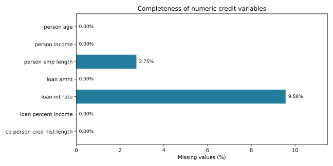

# Credit Data Explorer

A reproducible Python workflow for examining numeric credit-record data. It reports completeness, descriptive statistics, correlations and data-quality flags, and exports aggregate tables and a missingness chart.



## Features

- Validates required columns and numeric values; rejects infinite values.
- Summarises seven numeric variables with counts, means, standard deviations and quartiles.
- Reports missing counts and percentages for each variable.
- Computes pairwise Pearson correlations alongside the observation count for every pair.
- Flags exact duplicate rows, ages above 100, employment duration above age and negative numeric values.
- Retains all rows so users can review quality flags before choosing a cleaning policy.
- Exports CSV tables, a JSON audit and an SVG chart.

## Results

The analysed dataset contains **32,581 records**. Of these, **28,638** are complete across the seven numeric variables.

| Check | Count |
|---|---:|
| Missing employment duration | 895 |
| Missing loan interest rate | 3,116 |
| Exact duplicate rows beyond the first occurrence | 165 |
| Ages above 100 | 5 |
| Employment duration above age | 2 |

The other five numeric fields have no missing values. All seven fields have no negative values. Quality flags identify records for review; they do not establish that a value is necessarily an error.

## Run

Requires Python 3.10+:

```sh
python -m pip install -r requirements.txt
python -m unittest -v
python analyze.py /path/to/credit_records.csv --output output
```

Tests use synthetic fixtures and run without a source dataset. The analysis command requires a local CSV containing:

```text
person_age, person_income, person_emp_length, loan_amnt,
loan_int_rate, loan_percent_income, cb_person_cred_hist_length
```

Additional columns are permitted and included when detecting exact duplicate rows. Numeric missing values remain missing; nonnumeric text is rejected. Input records are not bundled. Existing output files are overwritten, so choose a different destination to preserve the published results.

## Outputs

| File | Purpose |
|---|---|
| `numeric_summary.csv` | Descriptive statistics and missingness |
| `correlations.csv` | Pairwise Pearson coefficients |
| `correlation_pair_counts.csv` | Available observations for each coefficient |
| `audit.json` | Dimensions, completeness and quality flags |
| `missingness.svg` | Percentage missing by numeric variable |
| `verification.txt` | Executed validation checks |

## Method and scope

Correlations use pairwise complete observations and require at least three pairs. Constant variables and insufficient pairs produce `NA`, not zero. Each coefficient may use a different sample; the pair-count table makes this explicit. Exact duplicates are reported without automatic deletion. Descriptive statistics use available values and sample standard deviations.

This is an exploratory data-quality project. Results describe the supplied records; they do not establish causality, creditworthiness or predictive performance. The workflow does not score borrowers or make lending decisions. Units and variable definitions should be checked against the user's dataset before interpretation.

## Validation

Five automated tests cover missing values and pair counts, constant variables and insufficient pairs, duplicate detection and review flags, invalid inputs, and output generation. An independent numerical check verifies the income–loan-amount correlation and reconciles all seven missing-value counts with the exported summaries.
